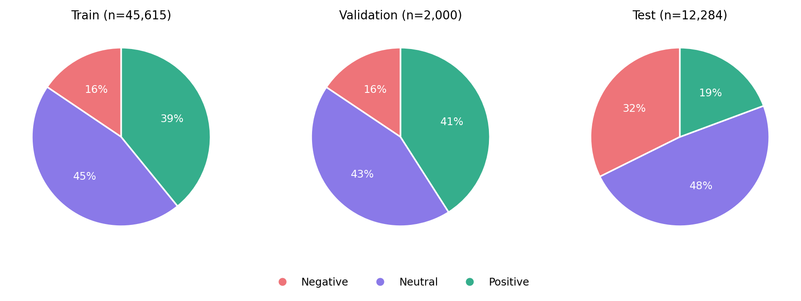
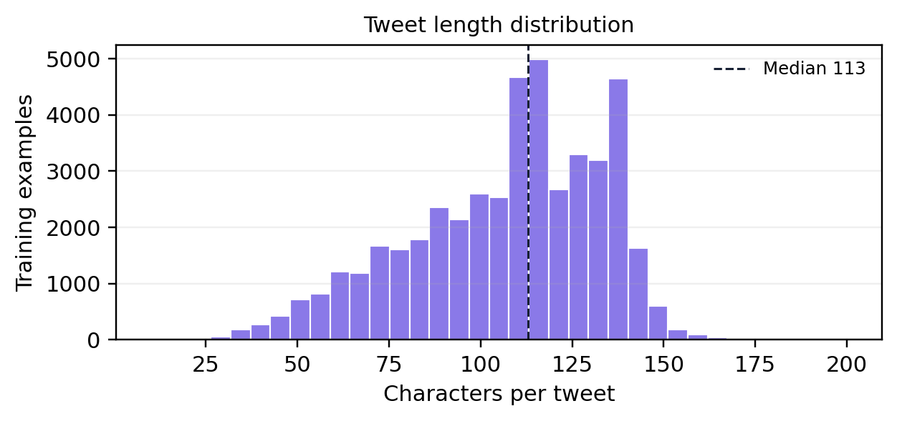
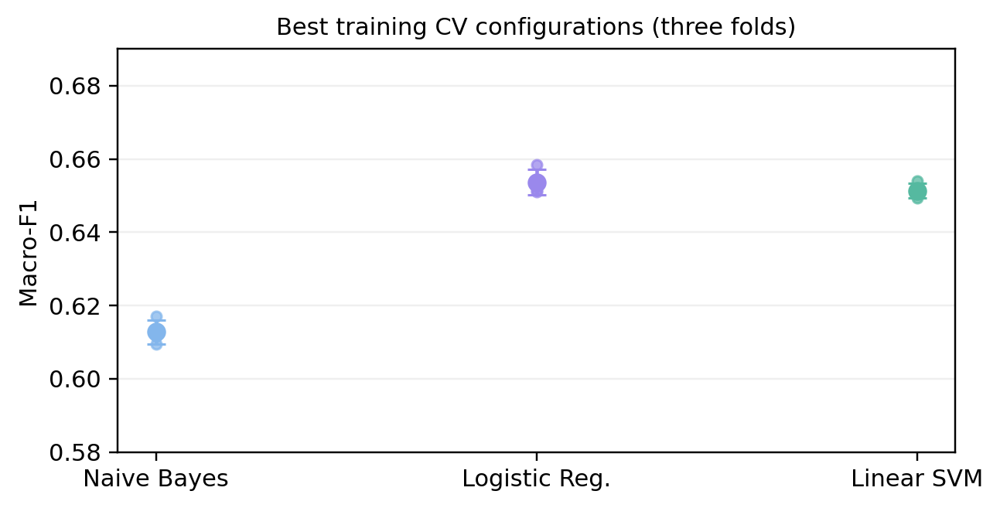
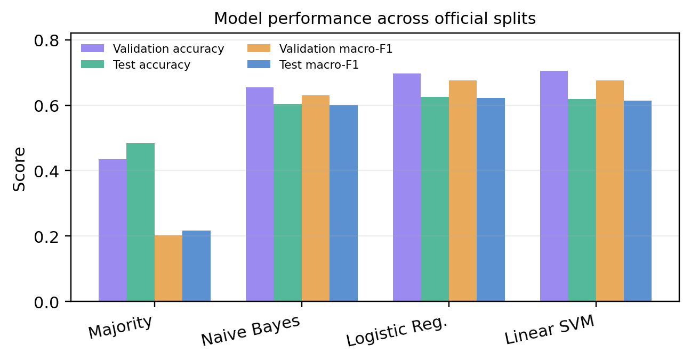
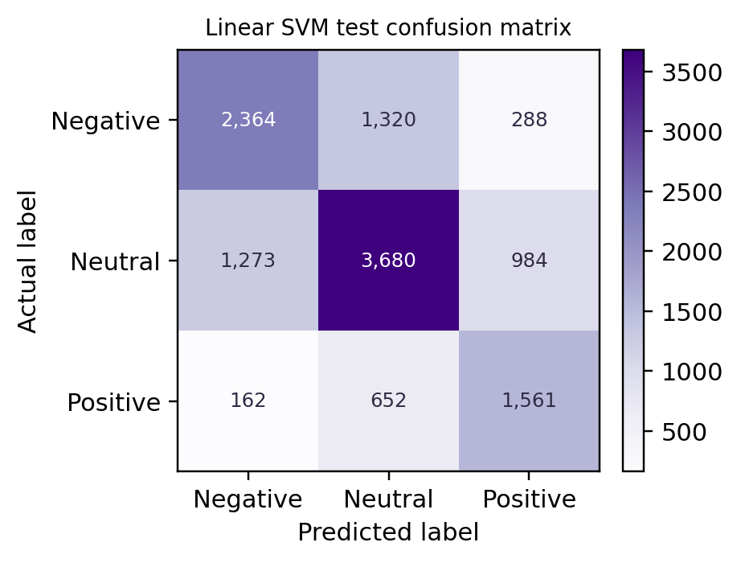
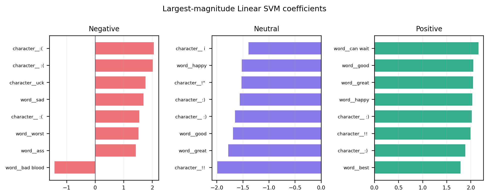
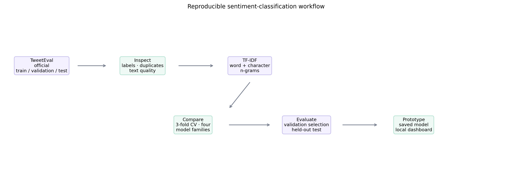

# Three-Class Tweet Sentiment Classification

**Student:** Dattu Nayak Paltya  
**Student ID:** I26043443  
**Module:** PRG4206 Machine Learning  
**Institution:** INTI International University, Malaysia

## Project summary

This project develops an end-to-end machine-learning system for classifying English-language tweets into **negative**, **neutral**, and **positive** sentiment. It uses the sentiment task from TweetEval, a public benchmark with fixed training, validation, and test partitions. Word- and character-level TF-IDF features are compared with Multinomial Naive Bayes, Logistic Regression, and Linear Support Vector Machine (SVM). A majority-class classifier provides a baseline.

The experiment separates hyperparameter tuning, model-family selection, and final evaluation. Stratified three-fold cross-validation on the official training partition selects a configuration for each model family by mean macro-F1. Validation macro-F1 selects the final family. The official test split is kept for final reporting. This protocol selects Linear SVM even though Logistic Regression scores slightly higher on the test split; selecting the alternative after seeing test results would use the test set for model selection.

The implementation includes reusable training and inference code, CSV exports, saved evaluation artifacts, an executable Jupyter notebook, and a local interactive dashboard. The measured performance is moderate: the selected Linear SVM reaches **61.9% test accuracy** and **61.4% test macro-F1**. It does not achieve the aspirational 80% accuracy.

## Research question and scope

The research question is: **How effectively can classical machine-learning models classify tweets as negative, neutral, or positive when evaluated using the fixed TweetEval sentiment partitions?**

The target is the benchmark sentiment label. The system does not infer a writer's actual emotional state, identify the target of an opinion, measure sentiment intensity, detect sarcasm reliably, or make moderation decisions. Results describe performance on this historical benchmark; they do not establish accuracy on current posts, other platforms, other languages, or a particular organization's messages.

## Dataset and provenance

The data is the `sentiment` configuration of the public [`cardiffnlp/tweet_eval` Hugging Face dataset](https://huggingface.co/datasets/cardiffnlp/tweet_eval), which is based on the TweetEval benchmark introduced by Barbieri et al. [1], [2]. The dataset has two modeling fields: tweet `text` and integer `label`, where 0 denotes negative, 1 neutral, and 2 positive. The project does not use author identity, timestamps, engagement counts, or profile metadata.

| Official partition | Examples |
|---|---:|
| Training | 45,615 |
| Validation | 2,000 |
| Test | 12,284 |
| **Total** | **59,899** |

The benchmark release appeared in 2020, while its sentiment examples originate from SemEval-2017 Task 4A and earlier source material [1], [3]. The release date and the age of the underlying posts are not the same. Whether the benchmark release satisfies a course recency requirement that might refer to the raw posts needs confirmation from the lecturer. The dataset card reports the license as unknown and the source repository notes that component-dataset and platform restrictions may apply [2], [4]. The project does not claim unrestricted redistribution rights.

TweetEval has been used in later research, including TimeLMs [5], XLM-T [6], and supervised contrastive learning for microblog classification [10]. These studies establish relevant benchmark use and research context, but their scores are not treated as directly comparable unless their precise split, preprocessing, and metric protocols are verified. The original benchmark and dataset documentation remain the primary sources for the task and split definitions.

## Data understanding and quality

The label proportions are not identical across the official partitions:

| Partition | Negative | Neutral | Positive |
|---|---:|---:|---:|
| Training | 7,093 (15.5%) | 20,673 (45.3%) | 17,849 (39.1%) |
| Validation | 312 (15.6%) | 869 (43.5%) | 819 (41.0%) |
| Test | 3,972 (32.3%) | 5,937 (48.3%) | 2,375 (19.3%) |

The test partition contains a notably larger proportion of negative examples and a smaller proportion of positive examples than the training and validation partitions. This distribution difference is retained rather than hidden by resampling the official test data. Training tweet text ranges from 10 to 200 characters, with a mean length of approximately 106.9 and a median of 113 characters.

Integrity checks found no missing text, blank text, or labels outside the three documented classes in any split. There are 26 exact duplicate `(text, label)` rows in training and none in validation or test. Training duplicates are retained to preserve the distributed benchmark partition. Their repeated contribution to fitting remains a limitation; their existence alone is not proof of train/test leakage.

The project exports one combined file, [`data/data.csv`](./data/data.csv), containing a `split` field, and separate [`train.csv`](./data/train.csv), [`validation.csv`](./data/validation.csv), and [`test.csv`](./data/test.csv) files. Each export has `text`, numeric `label`, readable `sentiment`, and `split` columns.

## Preprocessing and feature engineering

Raw text and official partition membership are preserved. The model uses a scikit-learn pipeline that constructs two sparse TF-IDF views:

* **Word features:** lowercased, Unicode accent-normalized unigrams and bigrams; minimum document frequency 2; vocabulary cap 100,000; sublinear term-frequency scaling.
* **Character features:** character n-grams of lengths 3–5 within word boundaries; minimum document frequency 3; vocabulary cap 100,000; sublinear term-frequency scaling.

Word features capture terms and short expressions, while character fragments can represent spelling variation, contractions, punctuation patterns, and parts of informal words. The combined features are fitted as part of each estimator pipeline. Consequently, every cross-validation fold learns its vocabulary and inverse-document-frequency weights from its own training portion rather than from its held-out fold. Validation and test text do not determine the fitted vocabulary.

No manual deletion, imputation, or normalization of the original tweet records is applied. This preserves benchmark integrity and avoids subjective text edits, while the vectorizers perform the transformations required for modeling.

## Models and experimental design

Four model families are compared:

1. **Majority baseline:** predicts the most frequent training class for every example.
2. **Multinomial Naive Bayes:** additive smoothing values `alpha ∈ {0.1, 0.5, 1.0}`.
3. **Logistic Regression:** balanced class weights, maximum 1,000 iterations, and `C ∈ {0.5, 1.0, 2.0}`.
4. **Linear SVM:** balanced class weights and `C ∈ {0.25, 0.5, 1.0}`.

Stratified three-fold cross-validation uses shuffled folds with random seed 42. Macro-F1 is the tuning score. Each selected configuration is refitted on the complete training split. The family with the highest validation macro-F1 is selected, and the untouched official test partition is then used for final comparison and error analysis.

Accuracy measures the overall proportion of correct predictions. Macro precision, macro recall, and macro-F1 calculate the respective class score for each sentiment and give the three classes equal weight. Reporting both accuracy and macro-averaged scores makes it harder for the larger classes to conceal weak class-specific performance. A paired bootstrap with 1,000 resamples of the same test indices estimates intervals for differences in macro-F1 between the selected model and alternatives; these intervals quantify uncertainty conditional on this benchmark test sample, not future-domain generalization.

## Results

### Cross-validation and validation selection

| Model | Selected configuration | CV macro-F1 (mean ± SD) | Validation accuracy | Validation macro-F1 |
|---|---|---:|---:|---:|
| Majority baseline | — | 0.2079 ± 0.0000 | 0.4345 | 0.2019 |
| Multinomial Naive Bayes | `alpha=0.1` | 0.6127 ± 0.0032 | 0.6545 | 0.6301 |
| Logistic Regression | `C=1.0` | **0.6536 ± 0.0034** | 0.6975 | 0.6758 |
| Linear SVM | `C=0.25` | 0.6513 ± 0.0020 | **0.7045** | **0.6765** |

Logistic Regression has the highest mean cross-validation macro-F1. Linear SVM has the highest validation macro-F1, by 0.0006 using the unrounded scores, and is selected under the declared validation rule.

### Official test results

| Model | Accuracy | Macro precision | Macro recall | Macro-F1 |
|---|---:|---:|---:|---:|
| Majority baseline | 0.4833 | 0.1611 | 0.3333 | 0.2172 |
| Multinomial Naive Bayes | 0.6045 | 0.5972 | 0.6083 | 0.6010 |
| Logistic Regression | **0.6246** | **0.6160** | **0.6336** | **0.6223** |
| Linear SVM (validation-selected) | 0.6191 | 0.6081 | 0.6241 | 0.6143 |

The selected SVM substantially exceeds the majority baseline on macro-F1 but misclassifies approximately 38% of test examples. Logistic Regression scores higher on this test sample; its paired SVM-minus-Logistic macro-F1 difference is −0.0079, with a 95% percentile bootstrap interval of approximately **[−0.0126, −0.0032]**. The validation-selected model remains SVM because the test set is not used to revise selection.

### Project graphs

**Sentiment label proportions in the official partitions**



**Tweet length distribution in the training partition**



**Cross-validation macro-F1**



**Validation and held-out test performance**



**Selected Linear SVM test errors**



**Feature associations learned by the selected model**



**End-to-end workflow**



| SVM test class | Precision | Recall | F1 | Support |
|---|---:|---:|---:|---:|
| Negative | 0.6223 | 0.5952 | 0.6084 | 3,972 |
| Neutral | 0.6511 | 0.6198 | 0.6351 | 5,937 |
| Positive | 0.5510 | 0.6573 | 0.5995 | 2,375 |

Positive-class precision is the weakest of the three classes, while positive recall is higher; some non-positive examples are therefore incorrectly labeled positive. The confusion matrix, class-distribution chart, and model-comparison plots are included in `artifacts/` and in the report. Aggregate metrics do not identify the linguistic cause of each error.

## System implementation

The training, evaluation, inference, and shared preprocessing logic are implemented in [`src/model.py`](./src/model.py). The saved model contains the fitted TF-IDF transformations and Linear SVM together. [`app.py`](./app.py) and [`web/`](./web/) provide a local dashboard with split distributions, model metrics, cross-validation results, a confusion matrix, dataset filtering, and text prediction. The executable [`TweetEval_Sentiment_Classification.ipynb`](./TweetEval_Sentiment_Classification.ipynb) documents the experiment and displays its analysis.

The `artifacts/` directory contains `results.json`, `metrics.csv`, cross-validation records, the selected-model test report, test predictions, a confusion-matrix plot, class and text-length summaries, linear-feature explanations, the serialized model, and paired-bootstrap comparisons. These files describe the saved run and should be regenerated together after a modeling or data change.

The unit-test suite covers the three-class pipeline, stratified cross-validation configuration, CSV export schema, dashboard data operations, deterministic paired-bootstrap comparisons, and BERTweet metric calculation. The latest verification completed successfully with **eight passing tests**.

### Experimental BERTweet fine-tuning

The classical TF-IDF model does not meet a 75–80% test-accuracy target. An optional BERTweet fine-tuning workflow is available in `src/bertweet.py`; it selects the checkpoint using validation accuracy and evaluates the held-out test split only after selection. No improved score is claimed until this experiment has actually run. The test split has a different class distribution from training and validation, so even a strong validation result may not transfer to test.

To run it in Google Colab:

1. Create a notebook with **Runtime → Change runtime type → T4 GPU**, then verify that `!nvidia-smi` shows a GPU.
2. Upload or clone this repository into the Colab runtime. If using Google Drive, mount it and choose a Drive path for the output so the model survives runtime shutdown.
3. Install the optional dependencies and run fine-tuning from the repository root:

   ```python
   %pip install -r requirements-bertweet.txt
   !python -m src.bertweet --output-dir /content/drive/MyDrive/tweet-sentiment/bertweet
   ```

   Mount Google Drive first if using the example output path. Training downloads `vinai/bertweet-base`; it needs working access to Hugging Face and may take substantial GPU time.

4. Inspect `results.json` in the output directory. Compare its `test.accuracy` with the existing **0.6191** test accuracy. The saved model is in the output directory's `model/` subfolder.

To use the trained model on the website, upload the output's `model/` folder to a private Hugging Face model repository from Colab with `huggingface_hub` (use `notebook_login()`; never put an access token in project code). In the backend host, install `requirements-bertweet.txt` as well as `requirements.txt`, then set `MODEL_BACKEND=bertweet` and `BERTWEET_MODEL=<your-account>/<your-model-repository>`. For a private model repository, provide its read token through the host's secret environment-variable settings as `HF_TOKEN`. Alternatively, for local inference, copy the model folder to `artifacts/bertweet/model`; the app will use that directory when `BERTWEET_MODEL` is unset.

BERTweet needs substantially more memory and startup time than the current 12 MB scikit-learn model; check the hosting plan's RAM limits before switching a live service. Do not commit model weights to Git—the generated model directory is ignored by `.gitignore`. The default remains `MODEL_BACKEND=sklearn` until the new model has been evaluated and deployed deliberately.

## Deploy the site and model backend

The dashboard is a single Python web service: `app.py` serves the website, JSON API, and predictions from the saved model. The fitted model is loaded once when the service starts; it is not retrained on each request. The frontend and API share one origin, so no separate frontend host or cross-origin configuration is needed. [`render.yaml`](./render.yaml) defines a Render Blueprint for this service. The server binds to the platform-provided `PORT`, and `/health` reports whether the model has loaded.

### Deploy with Render

1. Create a **private** GitHub repository for this project if you have not already created one. From PowerShell in the project directory, commit and push the project files:

   ```powershell
   git add .gitignore README.md requirements.txt requirements-bertweet.txt render.yaml app.py src data artifacts web reports TweetEval_Sentiment_Classification.ipynb
   git commit -m "Add optional BERTweet training workflow"
   git push origin main
   ```

   The tracked `artifacts/sentiment_model.joblib`, evaluation files, and `data/*.csv` are required by the live dashboard. The current model is approximately 12 MB and the data exports total approximately 10 MB. Do not delete them from the deployment repository.

2. Sign in to Render, choose **New → Blueprint**, connect the private repository, and select the `render.yaml` file at the project root. Render reads the blueprint, installs `requirements.txt`, starts `python app.py`, and registers `/health` as the health-check endpoint. Confirm and deploy the service.

3. When the deployment reports **Live**, open the `onrender.com` URL shown in the Render service page. Check `/health`; the expected response is `{"status":"ok"}`. Then use the prediction panel with a short test sentence and confirm it returns a sentiment. The charts and summary use the saved run artifacts.

4. For a private demonstration, configure access controls in the hosting service or keep the URL undistributed. The dashboard's example explorer returns source tweet text, and the dataset card lists its license as unknown. Review applicable dataset and platform terms before exposing the explorer to the public; a private GitHub repository alone does not make a public website private.

### Keeping the backend alive

The Render Blueprint uses the free web-service plan to make an initial deployment possible. Free services can spin down after a period without traffic, so the first request after inactivity may take time to wake the service. This is **not** an always-on deployment. If the model API must remain warm and respond without a cold start, change the service to an always-on paid instance in Render's dashboard and confirm the current plan and billing in Render before accepting the change. The process loads the saved model into memory at startup, then handles prediction requests until the service restarts or is redeployed.

The service requires the checked-in model artifact, CSV exports, and metric files to be present at deployment time. Render's local filesystem should be treated as disposable across deployments; the model does not write user data or retrain itself. To change model behavior, retrain and verify the project locally, update the model and its associated artifacts together, then push a new revision. The dependency file pins scikit-learn to **1.8.0**, matching the saved estimator's serialization version.

The hosted service is suitable as a coursework demonstration, not as a production decision system. The current application has no user authentication, request-rate limiting, monitoring, or decision-review workflow. Do not submit sensitive or personal text to the public prediction endpoint, and do not use predictions for consequential decisions.

## Limitations and responsible use

The test-set class proportions differ materially from the training and validation proportions, and the corpus predates current social-media usage. Tweet sentiment is contextual: sarcasm, negation, slang, mixed opinions, and short messages can produce ambiguous labels. TF-IDF n-grams do not model conversational context or long-range semantics. Benchmark labels reflect annotation conventions and should not be interpreted as objective measures of an author's private feelings.

Cross-validation supports model and parameter selection within the training distribution; it does not eliminate distribution shift, guarantee future performance, or promise an 80% score. A single benchmark result does not establish fairness across dialects or groups. The dataset card lists its license as unknown, so use and redistribution must respect the dataset and source-platform terms. The dashboard is an educational local prototype, not a production decision system. Predictions should not be used alone for moderation or other consequential decisions; aggregate exploratory use requires human review and clear communication of error.

The report discusses potential extensions—temporal external evaluation, systematic human-coded error analysis, lexicon baselines, and carefully governed pretrained models—as future work. These extensions have not been completed in the reported experiment.

## Project files

| Path | Purpose |
|---|---|
| [`src/model.py`](./src/model.py) | Dataset loading, exports, feature pipeline, CV, training, metrics, explanations, and inference |
| [`src/bertweet.py`](./src/bertweet.py) | Optional GPU BERTweet fine-tuning and inference |
| [`requirements-bertweet.txt`](./requirements-bertweet.txt) | Optional BERTweet/Colab dependencies |
| [`render.yaml`](./render.yaml) | Render Blueprint for the live web service |
| [`data/`](./data/) | Combined and official-split CSV exports |
| [`artifacts/`](./artifacts/) | Saved metrics, predictions, plots, explanations, and model |
| [`TweetEval_Sentiment_Classification.ipynb`](./TweetEval_Sentiment_Classification.ipynb) | Complete narrative and executable experiment |
| [`app.py`](./app.py), [`web/`](./web/) | Local interactive dashboard |
| [`reports/IEEE_report_source.md`](./reports/IEEE_report_source.md) | Full report text |
| [`I26043443_Dattu_Nayak_Paltya_Report.pdf`](./I26043443_Dattu_Nayak_Paltya_Report.pdf) | 15-page IEEE-style report PDF |
| [`I26043443_Dattu_Nayak_Paltya_Report.docx`](./I26043443_Dattu_Nayak_Paltya_Report.docx) | Editable 17-page report |

## References

[1] F. Barbieri, J. Camacho-Collados, L. Espinosa Anke, and L. Neves, “TweetEval: Unified benchmark and comparative evaluation for tweet classification,” *Findings of EMNLP*, 2020. [DOI: 10.18653/v1/2020.findings-emnlp.148](https://doi.org/10.18653/v1/2020.findings-emnlp.148).  
[2] Cardiff NLP, “TweetEval dataset card: sentiment configuration.” [Hugging Face dataset card](https://huggingface.co/datasets/cardiffnlp/tweet_eval).  
[3] S. Rosenthal, N. Farra, and P. Nakov, “SemEval-2017 task 4: Sentiment analysis in Twitter,” *Proceedings of SemEval*, 2017. [DOI: 10.18653/v1/S17-2088](https://doi.org/10.18653/v1/S17-2088).  
[4] Cardiff NLP, “TweetEval: Unified benchmark and comparative evaluation for tweet classification.” [Official repository](https://github.com/cardiffnlp/tweeteval).  
[5] D. Loureiro et al., “TimeLMs: Diachronic language models from Twitter,” *ACL System Demonstrations*, 2022. [DOI: 10.18653/v1/2022.acl-demo.25](https://doi.org/10.18653/v1/2022.acl-demo.25).  
[6] F. Barbieri, L. Espinosa Anke, and J. Camacho-Collados, “XLM-T: Multilingual language models in Twitter for sentiment analysis and beyond,” *LREC*, 2022. [ACL Anthology](https://aclanthology.org/2022.lrec-1.27/).  
[7] B. Pang and L. Lee, “Opinion mining and sentiment analysis,” *Foundations and Trends in Information Retrieval*, vol. 2, nos. 1–2, pp. 1–135, 2008. [DOI: 10.1561/1500000011](https://doi.org/10.1561/1500000011).  
[8] B. Pang, L. Lee, and S. Vaithyanathan, “Thumbs up? Sentiment classification using machine learning techniques,” *EMNLP*, 2002. [DOI: 10.3115/1118693.1118704](https://doi.org/10.3115/1118693.1118704).  
[9] C. Hutto and E. Gilbert, “VADER: A parsimonious rule-based model for sentiment analysis of social media text,” *ICWSM*, vol. 8, no. 1, pp. 216–225, 2014. [DOI: 10.1609/icwsm.v8i1.14550](https://doi.org/10.1609/icwsm.v8i1.14550).  
[10] J. Huang and R. Usbeck, “Revisiting supervised contrastive learning for microblog classification,” *EMNLP*, 2024. [DOI: 10.18653/v1/2024.emnlp-main.876](https://doi.org/10.18653/v1/2024.emnlp-main.876).  
[11] D. Q. Nguyen, T. Vu, and A. T. Nguyen, “BERTweet: A pre-trained language model for English tweets,” *EMNLP System Demonstrations*, 2020. [DOI: 10.18653/v1/2020.emnlp-demos.2](https://doi.org/10.18653/v1/2020.emnlp-demos.2).  
[12] M. Sokolova and G. Lapalme, “A systematic analysis of performance measures for classification tasks,” *Information Processing & Management*, vol. 45, no. 4, pp. 427–437, 2009. [DOI: 10.1016/j.ipm.2009.03.002](https://doi.org/10.1016/j.ipm.2009.03.002).  
[13] M. T. Ribeiro, S. Singh, and C. Guestrin, “‘Why should I trust you?’: Explaining the predictions of any classifier,” *KDD*, 2016. [DOI: 10.1145/2939672.2939778](https://doi.org/10.1145/2939672.2939778).
